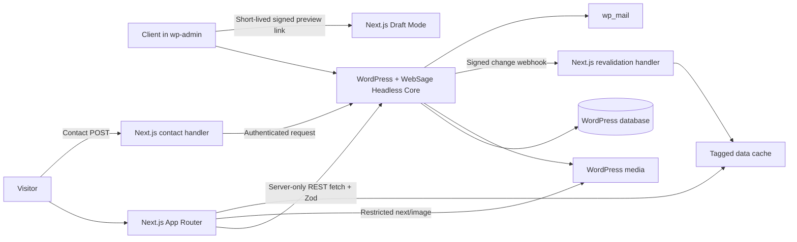

# WebSage Headless architecture

Status: Phase 1 proposal; awaiting approval. Date: 2026-10-16.
No application implementation, installation, deployment, or runtime validation is included.

## Brief and architectural options

Build a commercially distributable, repeatedly deployable Next.js/WordPress kit for freelance developers and agencies. Clients edit branding, navigation, sections, posts and SEO in wp-admin, preview unpublished changes, and publish without a frontend redeploy. Required outcomes include Linux local development, accessible responsive rendering, safe server-side data handling, and documented rebranding in under an hour.

Recommended: a pnpm monorepo with a plugin-owned REST boundary and shared Zod contracts. It keeps editorial ownership in WordPress and rendering ownership in Next.js, with fixtures checking the PHP/TypeScript boundary. Alternative: independently versioned frontend/plugin repositories improve separate releases but complicate contract synchronization and buyer setup. Alternative: a core-REST-only adapter reduces custom routes but cannot provide the specified settings, menu and section contracts without equivalent custom integration. The latter two are not proposed for v1. No WPGraphQL, ACF, extra framework or paid dependency is proposed.

## System overview



WordPress owns persisted content and abuse limits. Next.js owns public HTML, sanitization, route metadata, and browser-facing handlers. Contracts own runtime schemas and inferred TypeScript types. PHP response mappers are validated against shared JSON fixtures; importing TypeScript into PHP is not required.

## Repository structure

```text
apps/web/
  app/                         # root, [...slug], blog, api, sitemap, robots
  components/{layout,sections,ui}/
  lib/{api,security,seo,sections}/
  config/                      # fonts and fallback tokens
packages/contracts/
  src/{primitives,sections,site,pages,posts,contact,events}/
  fixtures/                    # valid/invalid wire payloads shared with PHP tests
packages/wp-plugin/
  websage-headless-core.php
  uninstall.php
  composer.json
  src/{Admin,Blocks,Content,Fields,Rest,Security,Revalidation,Preview,Seed,Support}/
  blocks/                      # block.json, editor source, deprecations
  build/                       # compiled editor assets
  tests/{unit,integration,fixtures}/
  vendor/                      # packaged, not committed
  languages/
demo/                          # seed assets and expected content
scripts/                       # validation and distribution tooling
docs/
.ddev/                         # PHP 8.3 + WordPress + database + plugin mount
.github/workflows/
```

Inspection found only the master prompt in the project. Git currently resolves to `/home/duanef/Pictures`, with unrelated existing staged/untracked files. Recommend a dedicated repository here before Phase 2; do not modify or commit unrelated parent work.

## WordPress data model

| Entity | Storage and editorial access | Public mapping |
|---|---|---|
| Pages | Native hierarchical `page`, revisions, featured image, Gutenberg | Root `/` via `page_on_front`; nested paths supported |
| Blog | Native `post`, categories, revisions, featured image | `/blog/{slug}`; no author identity exposed |
| Testimonials | `ws_testimonial`, title + plain quote in native content; CMB2 author metadata; edit_posts capabilities | Resolved inside testimonial sections only, published records only |
| Global CTAs | `ws_cta`, title + CTA block; revisioned, edit_posts capabilities | Resolved by CTA reference sections |
| Submissions | `ws_submission`, private, not publicly queryable, no core REST; custom admin-only capabilities | Never returned by public routes |
| Menus | `primary`, `footer` native menu locations | Normalized recursive link trees in `/site` |
| Synced patterns | Native `wp_block`; resolve references with cycle detection | Expanded into section data, never raw arbitrary blocks |
| Settings | Single `wsh_settings` option with `schema_version: 1`; `autoload: false` | Explicit public subset in `/site` |
| Operational state | Separate private retry, replay and rate-limit storage | Diagnostics only, manage_options |

Reserve `/blog`, `/api`, `/preview` and framework asset paths. Prevent conflicting page paths in admin and reject collisions in diagnostics. Native post categories are the only v1 taxonomy; no custom taxonomy. Changing slugs updates routes and invalidates both old/new paths. Redirect history is a future extension; removed URLs return 404 in v1.

## Block catalogue and schema specification

All block names below carry `websage/`. Attributes use JSON values stored in block comments, never DOM-derived sources. All have `schemaVersion: 1`; serializer-generated output sections additionally have deterministic `key` strings from traversal position and reference context. API `type` equals the suffix shown below. All object schemas are strict. Tables specify the schemas to implement, not executable Zod code.

Primitives: `Text` string ≤ 500; `RichText` allowlisted inline HTML ≤ 20,000; `BodyHtml` allowlisted block HTML ≤ 100,000; `MediaId` positive integer or null; `Url` safe relative frontend path or absolute HTTPS URL ≤ 2,048; `Link` `{label: Text, href: Url, newTab: boolean}`; `Image` `{url: HTTPS, alt: Text, width: positive integer, height: positive integer}`. Media IDs resolve to Image|null and never cross the public boundary. Rich text is sanitized again in Next.js. `theme` is `default|muted|brand`, never arbitrary CSS. Optional links/images use explicit nulls. Headings are plain text. Per-page limits: 100 sections, depth 8, total serialized data 1 MiB; reject excessive structures with logged diagnostics.

| Block | Stored attributes beyond schemaVersion | Allowed child blocks | Public Zod schema / transformation |
|---|---|---|---|
| hero | eyebrow:Text, heading:Text, body:RichText, imageId:MediaId, primary:Link|null, secondary:Link|null, theme | none | HeroSection: same, image replaces imageId |
| text-image | heading:Text, body:BodyHtml, imageId:MediaId, position:left\|right, theme | none | TextImageSection: same, resolved image |
| feature-grid | heading:Text, introduction:RichText, columns:2\|3\|4, theme | feature (0–12) | FeatureGridSection: attributes + items:FeatureItem[] |
| feature | title:Text, body:RichText, imageId:MediaId, link:Link|null | none; feature-grid parent | FeatureItem: same, resolved image |
| cta | heading:Text, body:RichText, link:Link, theme | none | CtaSection: same |
| cta-reference | ctaId:positive integer, theme | none | Resolved to CtaSection; missing/unpublished reference omitted with diagnostic |
| testimonials | heading:Text, theme | testimonial-reference (0–12) | TestimonialsSection: attributes + items:Testimonial[] |
| testimonial-reference | testimonialId:positive integer | none; testimonials parent | Testimonial: quote:Text, author:Text, role:Text, company:Text, image:Image|null |
| faq | heading:Text, theme | faq-item (0–30) | FaqSection: attributes + items:FaqItem[] |
| faq-item | question:Text, answer:RichText | none; faq parent | FaqItem: same |
| contact | heading:Text, body:RichText, submitLabel:Text, successMessage:Text, theme | none | ContactSection: same; recipients and secrets never attributes |

`SectionSchema` is a discriminated union of HeroSection, TextImageSection, FeatureGridSection, CtaSection, TestimonialsSection, FaqSection, ContactSection and CoreContentSection. Every section has `type`, `schemaVersion`, `key`. Child item schemas omit `type` and key. Unknown section types are recognized by an outer envelope, logged and skipped in production, shown as warnings in development; malformed known sections fail the whole response validation. Do not let a catch-all unknown schema swallow invalid known types.

Curated core blocks: paragraph, heading, list/list-item, image and quote. They normalize into `CoreContentSection {type:'core-content', schemaVersion:1, key, html:BodyHtml}` in document order. Core heading level 1 becomes h2 to preserve one page h1. Blog post bodies follow the same block parser. No shortcodes, embeds or arbitrary block execution. `core/block` is accepted solely for supported synced pattern resolution with a visited-ID set. Restrict editor insertion per post type and per parent.

Dynamic leaf blocks save null; parents persist `InnerBlocks.Content` so children survive storage. No PHP frontend renderer. Versioned PHP attribute migrations are required because editor deprecations alone do not migrate every stored dynamic attribute. Include an initial deprecated fixture/migration path and test edited and unedited old content. Editor uses RichText/MediaUpload/InspectorControls from `@wordpress/block-editor`, controls from `@wordpress/components`, and the stable link control export supported by the pinned WordPress version. Check exports during implementation.

Page templates: home (hero, features, testimonials, CTA); standard (hero, text-image, CTA); contact (hero, contact, FAQ). Templates provide initial content and permit reordering. CTA CPT permits one CTA block; testimonials do not use the section editor.

## CMB2 field map

One options page `wsh-settings`, capability manage_options, tabs Branding, Header, Footer, Contact, SEO, Integration. No CMB2 REST exposure. Classes live in `src/Fields/` as SettingsPage, SeoMetabox, TestimonialMetabox. Every actual field, including group children, explicitly sets sanitization_cb and escape_cb. Validators reject invalid values rather than silently converting them into unsafe defaults.

| Class/tab | Field keys and types | Sanitization / output escaping |
|---|---|---|
| Settings/Branding | site_name text; logo file_id; font_heading, font_body select | sanitize_text_field / esc_attr; positive attachment lookup / esc_attr; enum allowlist / esc_attr |
| Settings/Branding | primary, on_primary, background, foreground, muted, on_muted, border, focus colorpicker | strict six-digit hex / esc_attr; reject contrast-breaking foreground/background combinations |
| Settings/Header | announcement text, announcement_link text_url | text / esc_attr; safe URL policy / esc_url |
| Settings/Footer | copyright text; description textarea_small; social group with label text, url text_url | text / esc_attr; sanitize_textarea_field / esc_textarea; structural array validator; each child text or URL callbacks |
| Settings/Contact | email text_email; phone text; address textarea_small; recipient text_email; retention_days text_small; delete_submissions_on_uninstall checkbox | sanitize_email + is_email / esc_attr; text / esc_attr; textarea / esc_textarea; bounded integer 1–365 / esc_attr; boolean / esc_attr |
| Settings/SEO | title_template text; description textarea_small; og_image file_id; organization_name text | text, textarea, attachment validators / matching attr or textarea escaping |
| Settings/Integration | frontend_url text_url; hardening, disable_xmlrpc, disable_user_enumeration checkboxes | HTTPS origin allowlist (local HTTPS allowed) / esc_url; boolean / esc_attr |
| SeoMetabox/page+post | _wsh_seo_title text; _wsh_seo_description textarea_small; _wsh_seo_image file_id; _wsh_seo_noindex checkbox | text, textarea, attachment, boolean validators / corresponding esc callbacks |
| TestimonialMetabox | _wsh_author, _wsh_role, _wsh_company text; _wsh_portrait file_id | text / esc_attr; attachment validation / esc_attr |

Font selects default to Sora/Montserrat, with approved bundled next/font alternatives and system fonts. Arbitrary remote font URLs are prohibited. Settings choose precompiled font families; adding a new downloaded font requires developer config/build. Public contact email differs from private notification recipient. Secrets are deployment environment values read through private config, never editable/readable CMB2 fields. Diagnostics show configured/not configured only. `wsh_settings.schema_version` is internal, with idempotent upgrade migrations and rollback backups. Canonicals derive from frontend origin and routes, avoiding arbitrary canonical entry.

## Full API contract

Base: `/wp-json/websage/v1`. JSON UTF-8, UTC ISO-8601 timestamps, no raw WordPress objects. Successful GET envelope: `{data:T}`. Error envelope: `{error:{code:string,message:string,requestId:string}}`. GET errors: 400 invalid input, 401/403 authentication, 404 unavailable resource, 413 size limit, 500 internal error, 503 dependency/configuration failure. Public missing/draft resources both return generic 404. No PHP warnings or stack traces in output. WordPress REST errors are adapted to this contract. Unknown request properties rejected on writes. Public endpoint responses use no browser/CDN cache by default; Next.js owns caching.

Common `Seo`: `{title:string,description:string,canonical:HTTPS,openGraphImage:Image|null,noindex:boolean}`. `Page`: `{path:string,title:string,modified:string,sections:Section[],seo:Seo}`. `PostSummary`: `{slug:string,path:string,title:string,excerpt:string,published:string,modified:string,image:Image|null,categories:{slug:string,name:string}[]}`. `Post`: summary plus `sections` and `seo`. `MenuItem`: `{label:string,href:Url,newTab:boolean,children:MenuItem[]}`, depth ≤3, ≤100 entries/menu. Rich text never occurs in labels. All examples are illustrative fixtures, not runtime output.

### GET /site — public

Returns site name, resolved branding, public contact, header/footer and menus. Fonts are IDs from the compiled allowlist. Tokens have the validated keys above. Defaults materialize server-side; no undefined keys.

```json
{"data":{"name":"WebSage Demo","branding":{"logo":null,"fonts":{"heading":"sora","body":"montserrat"},"tokens":{"primary":"#174F46","on_primary":"#FFFFFF","background":"#FFFFFF","foreground":"#17201E","muted":"#F2F5F4","on_muted":"#35443F","border":"#62736D","focus":"#126BDA"}},"header":{"announcement":"Welcome","announcementLink":null},"footer":{"description":"Independent expertise.","copyright":"WebSage Creative","social":[]},"menus":{"primary":[{"label":"Home","href":"/","newTab":false,"children":[]}],"footer":[]},"contact":{"email":"hello@example.com","phone":"","address":""}}}
```

### GET /pages/{slug} — public

`slug` is the full encoded hierarchical path; `home` aliases the configured front page. Normalize and reject traversal, reserved paths, excessive length and ambiguous encodings. Register a route permitting nested path segments. Frontend uses `/pages/home` for `/`.

```json
{"data":{"path":"/","title":"Home","modified":"2026-10-16T12:00:00Z","sections":[{"type":"hero","schemaVersion":1,"key":"0","eyebrow":"Welcome","heading":"Build with confidence","body":"<p>Made for your team.</p>","image":null,"primary":{"label":"Contact","href":"/contact","newTab":false},"secondary":null,"theme":"default"}],"seo":{"title":"Home | Demo","description":"Our demonstration site.","canonical":"https://www.example.com/","openGraphImage":null,"noindex":false}}}
```

### GET /posts?page=1&perPage=10&category=news — public

Page integer ≥1, perPage 1–100, category optional slug ≤200. Sort published descending, ID descending as stable tiebreaker. Unknown category gives empty result; a page beyond last returns empty items. TotalPages is 0 when total is 0. No separate category endpoint; list response includes all published category filter choices.

```json
{"data":{"items":[{"slug":"hello","path":"/blog/hello","title":"Hello","excerpt":"First update.","published":"2026-10-16T12:00:00Z","modified":"2026-10-16T12:00:00Z","image":null,"categories":[{"slug":"news","name":"News"}]}],"pagination":{"page":1,"perPage":10,"total":1,"totalPages":1},"categories":[{"slug":"news","name":"News"}]}}
```

### GET /posts/{slug} — public

```json
{"data":{"slug":"hello","path":"/blog/hello","title":"Hello","excerpt":"First update.","published":"2026-10-16T12:00:00Z","modified":"2026-10-16T12:00:00Z","image":null,"categories":[],"sections":[{"type":"core-content","schemaVersion":1,"key":"0","html":"<p>First update.</p>"}],"seo":{"title":"Hello | Demo","description":"First update.","canonical":"https://www.example.com/blog/hello","openGraphImage":null,"noindex":false}}}
```

### GET /routes?page=1&perPage=100 — public

PerPage ≤500; frontend follows all pages for sitemap/static params. Published routable pages/posts only, no private CPTs or noindex entries. Include `/blog` as a synthetic route whose modified date tracks posts. Homepage appears once. Missing homepage is a configuration error.

```json
{"data":{"items":[{"path":"/","kind":"page","modified":"2026-10-16T12:00:00Z"},{"path":"/blog","kind":"index","modified":"2026-10-16T12:00:00Z"},{"path":"/blog/hello","kind":"post","modified":"2026-10-16T12:00:00Z"}],"pagination":{"page":1,"perPage":100,"total":3,"totalPages":1}}}
```

### GET /preview/{id} — server authenticated

Positive ID is the selected post or revision ID. `Authorization: Bearer <WSH_SERVER_API_SECRET>` plus the signed preview grant in `X-WSH-Preview-Grant` bound to that ID. Authenticate both. Return `{data:{kind:'page'|'post',content:Page|Post}}`; no-store, private. Parent canonical remains public frontend URL. Example:

```json
{"data":{"kind":"page","content":{"path":"/draft","title":"Unpublished","modified":"2026-10-16T12:00:00Z","sections":[],"seo":{"title":"Unpublished","description":"","canonical":"https://www.example.com/draft","openGraphImage":null,"noindex":true}}}}
```

### POST /contact — server authenticated

Same bearer secret; maximum body 16 KiB. `ContactInputSchema`: name 1–120 plain characters, email valid ≤254, message 1–5,000, website honeypot ≤200, consent literal true, idempotencyKey UUID. Next.js supplies `X-WSH-Client-Hash` as HMAC-SHA256 of trusted client IP plus UTC date using a dedicated rate-limit secret. Never accept a browser-provided hash. Default 5 accepted attempts/15 minutes/hash; database atomic counters, not read-then-write transients. Retain hashes ≤24 hours. Misconfigured proxy trust fails closed. Optional Turnstile verified server-side when configured; no service needed by default.

```json
{"name":"A Visitor","email":"visitor@example.com","message":"Please contact me.","website":"","consent":true,"idempotencyKey":"86c1e718-ef94-4ca8-8e28-043850eedfa9"}
```

201: `{"data":{"accepted":true}}`; duplicate idempotency key with same payload returns same acceptance without another record/email; mismatched payload returns 409. Honeypot returns generic acceptance without storage. 422 validation error gives safe field codes; 429 includes Retry-After; 401 unauthorized; 503 unavailable storage. Store before attempting wp_mail; mail failure is logged and retried with bounded attempts, without asking visitors to resubmit. No submission ID exposed. Retention job deletes records older than configured days; diagnostics warn when scheduled tasks are overdue.

### Next.js browser and integration handlers

| Route | Contract |
|---|---|
| POST /api/contact | Same browser fields plus optional turnstileToken; Origin must match frontend; server validates and maps WP result; no caching |
| POST /api/revalidate | Signed event below; 200 `{data:{accepted:true}}`; 400 malformed, 401 bad/expired signature, 413 >64 KiB; no caching |
| GET /api/preview | Signed token; sets Draft Mode + scoped HttpOnly encrypted preview-grant cookie, 303 to validated content path; invalid token 401; no arbitrary redirect |
| POST /api/preview/exit | Same-origin check; clears Draft Mode and grant; 303 to `/`; no caching |

Webhook: headers `X-WSH-Timestamp` Unix seconds, `X-WSH-Event-Id` UUID, `X-WSH-Signature` hex HMAC-SHA256 of `timestamp + '.' + eventId + '.' + rawBody`. Body example:

```json
{"version":1,"event":"content.updated","resource":"page","paths":["/old-about","/about"],"tags":["page:/old-about","page:/about","routes"]}
```

Allowed events: content.updated, content.deleted, menu.updated, settings.updated. Resource: page, post, testimonial, cta, menu, settings. Handler validates tag grammar and allowed resource/tag combinations, constant-time signature comparison, ±300s timestamp window. Repeated delivery is intentionally harmless: signature expiry bounds replay and invalidation is idempotent; never claim persistent replay deduplication without shared storage. Plugin retries failures with backoff 10/60/300 seconds and fresh signatures, storing pending jobs privately. Diagnostics exposes last delivery outcome without secrets.

## Frontend architecture and failure behavior

Server-only API client exports getSite, getPage, getPosts, getPost, getRoutes and getPreview. Origin is deployment configuration, never browser input. Abort after 5 seconds, cap bytes, reject redirects to other origins, validate response envelopes and content. Throw descriptive schema errors in development. Production logs request IDs and safe failure details; route error boundary presents generic retry UI. Only a verified 404 produces notFound; outages never become cached 404s. Last valid cached data may be used when supported, otherwise show service-unavailable UI. Never cache invalid responses or preview data.

Section registry maps each known type to a Server Component and its props schema; the renderer preserves order. FAQ uses native details/summary, ContactForm and MobileMenu are client islands, back-to-top is a normal anchor unless interaction needs code. Header/Footer render site data. Blog pagination is URL-driven. Every route group supplies loading/error/not-found states; empty blog and missing optional sections have intentional empty states. Preview bypasses all content caches, including site settings.

Sanitize HTML in a single server-only module with a maintained allowlist sanitizer (proposed sanitize-html library; pin during Foundation). Permit paragraphs/headings/lists/quotes/emphasis/safe links/images; reject scripts, event handlers, style, iframe and unsafe protocols. Rewrite same-CMS links to frontend paths; uploaded media stays media. Prevent protocol-relative URLs, credentials, javascript/data URLs and open redirects. JSON-LD serialization escapes `<` and uses verified public values. Test adversarial HTML and URL fixtures. API data is untrusted even after Zod validation.

## Cache, revalidation and preview

Public data fallback TTL: 300 seconds. Tags: `site`, `page:{path}`, `post:{slug}`, `posts`, `routes`. Page caches include resolved reusable content; plugin reference index tracks referencing pages/posts when CTA/testimonial/pattern content changes. Settings/menu invalidate site; post mutations invalidate slug, lists and routes; page mutations invalidate old/new paths and routes. Dependencies of removed references remain captured until old cache entries are invalidated. Test trash, unpublish, slug changes, menu reassignment and category edits.

Use explicit immediate expiration for signed webhook events via the supported revalidateTag API (`{expire:0}` where supported by pinned Next.js); stale-while-revalidate `max` does not promise immediate fresh reads. Do not implement with the deprecated single argument API. Invalidate routes data and affected route output; verify actual framework data/full-route cache interaction in Phase 2/3.

Preview sequence: wp-admin capability + nonce checked action selects current autosave/revision, generates HMAC token `{v:1,id,parentId,path,iat,exp,jti}` expiring in 5 minutes. Dedicated preview secret; base64url payload and HMAC signature. Next.js verifies and obtains preview content server-side before redirecting. Store encrypted grant in Secure, HttpOnly, SameSite=Lax cookie limited to the grant’s five-minute lifetime, bound to selected ID/path; refresh via a new wp-admin preview when expired. After five minutes preview requires a new wp-admin preview link. All preview responses Cache-Control private,no-store, X-Robots-Tag noindex; draftMode alone never authorizes arbitrary draft IDs. Never log tokens; no third-party resources on the token receiver, Referrer-Policy no-referrer. Exit uses POST.

## Design system and accessibility

CSS variables own colors, typography, spacing, radii and shadows; Tailwind v4 theme mappings read variables. No component-specific literal brand colors. Resolve branding on server, serialize only validated token values, and map font IDs to next/font families loaded at build. Default Sora headings/Montserrat body. Layout works at 320px and respects reduced motion. Include skip link, visible focus, keyboard menu behavior, semantic landmarks, form errors/live region, adequate targets and contrast. Rebrand checklist changes logo, all tokens, font IDs; inspect every section, header/footer, form and error state with zero component edits.

## Security model and threat list

| Threat | Boundary/control | Required verification |
|---|---|---|
| Draft/PII disclosure | Published-only explicit mappers; grant-bound draft access; private submissions, no core REST exposure | Anonymous endpoint enumeration, revision/attachment parent checks |
| Stored/reflected XSS | Field callbacks, HTML allowlist, token enums, escaped admin views and JSON-LD | Malicious content and CSS/URL fixtures |
| Forged webhook/preview | Independent secrets, exact-byte HMAC, bounded lifetime, constant-time comparisons | Mutated body, timestamp, ID, path, signature tests |
| CSRF/admin privilege escalation | Capability checks + WP nonces; same-origin browser POST | Subscriber/editor/admin matrix; missing nonce/Origin tests |
| Spam and email abuse | Server proxy, honeypot, atomic hashed-IP limits, fixed configured recipient; no user email headers | Concurrent limit, forwarded-IP spoof, mail injection tests |
| SSRF/open redirects | Fixed origins, validated media host/path, no arbitrary external fetch, redirect restrictions | Loopback/unapproved host/protocol tests |
| Origin duplicate indexing | CMS noindex, core sitemap disabled, frontend redirect excluding admin/login/REST/media/cron/CLI | Redirect exclusions and no redirect loop tests |
| User enumeration/XML-RPC | Configurable REST user-route denial and author-archive hardening; XML-RPC disabled | Anonymous routes and author-query tests |
| Supply-chain/plugin conflicts | Locked dependencies, production vendor build, CMB2 coexistence, dependency inventory | Zip audit and two bundled CMB2 versions in both load orders |
| Availability/cache poisoning | Input/body/depth limits, timeouts, strict validation, generic errors | Oversized/cyclic fixtures, outage and malformed schema tests |
| Sensitive logs/backups | Redaction, configured retention, admin-only diagnostics | Token/body/email redaction checks |

CORS closed on custom namespace; do not globally break authenticated Gutenberg core REST. API authentication is server-to-server TLS, never a NEXT_PUBLIC secret. PHP namespace WebSage\HeadlessCore, wsh_ hooks/options, websage-headless text domain. REST write routes always have real permission callbacks. Prefer core APIs; custom atomic queries require prepared statements. Plugin activates only on approved minimum WP and PHP ≥8.1; tested PHP 8.3. Private admin fields have explicit escaping and native form nonces. Uninstall removes plugin settings/operational tables; submissions deleted only if opted in, leaving user content intact.

Next.js headers: HSTS on production HTTPS, nosniff, strict-origin-when-cross-origin, restrictive Permissions-Policy, CSP with frame-ancestors none and restricted image/connect/font sources. Recommend static-compatible CSP baseline for cached public routes; strict per-request nonce CSP on preview/dynamic responses where feasible. Nonce CSP on every route can force dynamic rendering; validate the chosen policy and caching together before claiming performance. next/image remotePatterns allow only configured CMS media host and upload path. TLS proxy forwarding is explicitly trusted/configured; no arbitrary X-Forwarded-For trust.

## Deployment model

Local: DDEV Linux, PHP 8.3, MariaDB, pinned WordPress, plugin bind mount, pnpm web dev; frontend reaches the CMS's trusted local HTTPS origin. DDEV does not bundle Docker Desktop; document supported Docker engine prerequisite. Seed through `wp websage seed`, stable seed IDs stored in metadata, transactional/upsert behavior and two-run duplicate assertions.

Managed Next.js: Vercel build installs frozen pnpm lockfile and builds apps/web; CMS hosted separately with HTTPS, environment secrets configured in both deployments. Build must handle unavailable CMS without embedding demo data in production; choose request-time rendering when build-time content fetch is unavailable. Preview and contact handlers use Node runtime.

Self-hosted: output standalone, ship standalone server plus static/public assets, Node LTS service behind TLS reverse proxy, trusted forwarding and correct Host; configure cache disk persistence and process permissions. Start one instance for baseline; multi-instance deployment requires approved shared cache/invalidation infrastructure or disabling persistent public caching across instances. cPanel/LiteSpeed is conditional on host supporting persistent compatible Node, reverse proxy, environment secrets and writable cache; document unsupported host cases rather than promising all cPanel plans. Static export unsupported because preview, contact and revalidation require a server.

Environment inventory: WP_API_ORIGIN, FRONTEND_ORIGIN, WORDPRESS_MEDIA_HOST; WSH_SERVER_API_SECRET, WSH_PREVIEW_SECRET, WSH_REVALIDATION_SECRET, WSH_RATE_LIMIT_SECRET; optional TURNSTILE_SECRET_KEY and public site key; proxy trust policy. WordPress obtains applicable values from server environment/config, never public REST. `.env.example` has dummy placeholders/descriptions only. Config changes to media host/fonts require rebuild. Production cron should invoke WordPress scheduled jobs reliably for retries/retention.

## Licensing and extension seams

Propose GPL-2.0-or-later for the WordPress plugin and bundled editor code, separate commercial license for apps/web. Recommend MIT for packages/contracts to permit plugin/frontend reuse, subject to owner/legal confirmation. Include third-party notices and preserve dependency licenses. Commercial distribution can include GPL code; do not promise that GPL-covered redistribution can be prohibited. Owner must obtain legal advice on boundaries, contracts licensing and commercial frontend terms before packaging. No license enforcement/update delivery in v1; isolate future plugin update client and frontend entitlement adapters.

Future seams: WooCommerce gets a separate authenticated commerce adapter/contracts; multilingual adds locale to routes/contracts/cache tags; multisite scopes settings/secrets/indexes by site; frontend accounts add independent authenticated routes/cookies with no shared public caches; visual builder could feed the section contract through a separate adapter. None are implemented or guaranteed compatible in v1.

## MVP execution sequence and exit evidence

Every phase ends with updated DECISIONS/PROGRESS and explicit owner approval.

| Phase | Ordered tasks | Evidence required |
|---|---|---|
| 1 Architecture | Inspect, verify version sources, specify contracts/data/flows/threats, record decisions and questions | Reviewed docs; approval pending |
| 2 Foundation | Isolate repo; exact dependency locks; workspace/tooling/CI; DDEV; plugin bootstrap/activation/PSR-4/CMB2; hero editor/build/parser; hero contracts/fixtures; API client; base layout/tokens/routes | pnpm lint/typecheck/test/build; PHP checks; fresh plugin activation with no other plugins; CI green; hero round trip; CMB2 two-version load-order test |
| 3 CMS integration | CMB2 settings/meta; all blocks/parser migrations; menus/CPTs; GET controllers; settings migration; reference index; signed revalidation/retry; preview; diagnostics/hardening | Endpoint/auth fixtures, editor publish/update/trash/menu/settings freshness, unpublished revision preview, no-cache assertions |
| 4 Features | All section renderers; mobile nav/form; blog; contact storage/limits/mail/retention; metadata/sitemap/robots/JSON-LD; repeatable seed | Playwright navigation/pages/blog/form success-invalid-rate limit/404/mobile; seed twice; rich-text security tests |
| 5 Hardening | PHPCS/PHPStan/PHPUnit; axe; threat matrix review; Lighthouse mobile; rebrand audit; outage/caching/deployment tests | Actual scores ≥90 in four Lighthouse categories or documented unmet gate; security findings resolved; written results/limitations |
| 6 Packaging | Install/developer/client/deploy/security docs; licenses; changelog; reproducible zip/starter build; clean-machine install | Only plugin required; production vendor/assets present; no secrets/dev files; timed install <30m following docs; full CI |

Small Conventional Commits by feature boundary; do not commit parent repository changes. Concrete implementation plan is written after architecture approval and before Phase 2 implementation.

## Approval questions

1. Approve this architecture and proposed repository layout? Recommend a dedicated Git repository at this directory before Foundation.
2. Approve license proposal (GPL plugin, commercial frontend, MIT contracts), with final terms reviewed by your legal adviser before distribution?
3. Confirm v1 default submission retention of 30 days (configurable 1–365) and fixed configured notification recipient. Provide commercial support/security contact before Phase 6.
4. Approve compiled font allowlist (defaults Sora/Montserrat), with wp-admin selection and developer rebuild for new font families?
5. Approve static-compatible public CSP plus nonce policy on dynamic preview routes, and single-instance standalone baseline? Shared-cache infrastructure needs a separate proposal if multi-instance self-hosting is required.
6. Approve setting the WordPress activation minimum to the initialization stable baseline 7.1.3, rather than claiming untested older-version compatibility?

These are explicit proposals awaiting approval, not silently settled product decisions. No Phase 2 work begins before the gate.
